# 💰 Finance Manager: Income, Expenses & Work Schedules

Finance Manager combines work schedules and expense records in a React and Express application. Users can import hourly schedules, review income and spending, and export reports as PDF, CSV, or Excel. MongoDB stores account data and financial records.

---

## 🎯 The "Why"

People who work variable hours need a record of both their shifts and their expenses. Finance Manager brings those records into one application. Its spreadsheet import includes a validation preview before records are saved, while reports can be filtered by date and exported for further review.

The project focuses on schedule-based income tracking. The monthly income estimate extrapolates from recorded hourly earnings; it is not a predictive budget model. Monthly-salary calculations currently differ between views, as documented below.

---

## 🛠 Tech Stack

### Frontend

* **Framework:** React 18.3, TypeScript, Vite 7
* **Styling:** Tailwind CSS, shadcn/ui and Radix UI components
* **State:** TanStack Query and authentication Context
* **Forms:** React Hook Form and Zod
* **Charts:** Recharts

### Backend

* **Runtime:** Node.js and Express
* **Database:** MongoDB with Mongoose
* **Authentication:** JWT, bcryptjs, Passport Google/GitHub strategies
* **Email:** EmailJS for verification and recovery codes
* **Files & Reports:** Multer, SheetJS (`xlsx`), PDFKit
* **API Documentation:** Swagger UI and swagger-jsdoc

### Security & DevOps

* **Request Controls:** Helmet headers, CORS, rate limits, and MongoDB operator sanitization
* **Authorization:** Verified-account checks, JWT token-version checks, and user-scoped record queries
* **Containers:** Root Dockerfile and Docker Compose for a combined frontend/API service
* **CI:** GitHub Actions for frontend checks, dependency audits, backend syntax checks, and container builds

---

## ✨ Key Features

### 📊 Financial Dashboard

* **Income and Expenses:** Review totals and net income within a selected date range.
* **Charts:** Daily hourly income, expenses by category, and weekly income/expense trends.
* **Schedule View:** Inspect work entries and switch the date filters or future-schedule view.

Data is fetched through REST endpoints and cached with TanStack Query. Dashboard queries have a five-minute stale time and do not refetch on window focus. The application does not provide a server-pushed live financial feed.

### 📅 Schedule Management

* **Pay Types:** Create hourly schedules with hours and rate, or monthly schedules with a salary value.
* **Selected Weekdays:** Repeated entries are created for selected weekdays within the chosen week's remaining dates. This action does not establish an ongoing recurrence rule.
* **Record Editing:** Update or delete individual schedules associated with the signed-in account.

### 📤 Spreadsheet Import & Validation

* **Accepted Files:** CSV, XLS, and XLSX uploads up to 10 MB. Only the first worksheet is parsed.
* **Required Columns:** `date`, `hours`, and `hourly_rate`; optional columns are `tag` and `notes`.
* **Preview:** The API returns the first ten preview rows with valid/invalid counts. Valid hourly entries are retained in a user-scoped, in-memory upload session for one hour.
* **Confirmation:** Selected valid row numbers are submitted through a separate confirmation request before insertion into MongoDB. Restarting the server discards pending previews.

Dates use `YYYY-MM-DD`. Hours must be greater than zero and at most 24. Import validation rejects missing or invalid values; inspect the preview before confirmation.

### 💸 Expense Tracking

* **Expense Records:** Add a date, place, and amount, with category and notes as applicable.
* **Receipts:** Attach JPEG, PNG, or PDF files up to 5 MB. New receipt bytes are stored with the expense in MongoDB after temporary upload processing.
* **Private Retrieval:** Receipt requests require authentication and ownership of the expense. Older records may rely on a local upload file.

### 📑 Report Exports

* **Scope:** Export schedules, expenses, or combined records for a selected period.
* **Formats:** PDFKit produces PDF reports; SheetJS produces CSV and XLSX files.
* **Review:** Compare monthly-salary figures with the calculation limitations below before relying on exported totals.

### 🔐 Account Access

* **Email Accounts:** Registration, OTP verification, password login, and recovery through EmailJS.
* **Social Login:** Google and GitHub sign-in through backend Passport strategies.
* **Session Checks:** Signed JWTs identify the account; protected routes also check verification status and token version.

### 🖥️ Responsive Interface

* **Navigation:** Dashboard, schedule entry/import, expenses, reports, and settings share a common layout.
* **Settings:** Profile changes, password changes, and account-data export are available through account routes.

---

## 🔄 Application Architecture

The frontend calls an Express REST API. Common middleware runs before route handlers. Authentication routes have their own rate limiter; financial routes require a verified user and a valid token before their shared API limiter and handlers run.

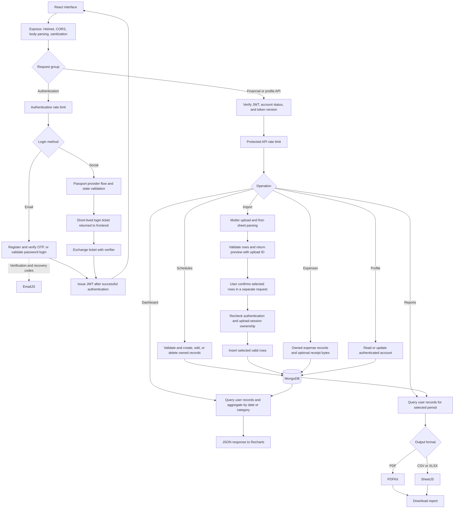

The confirmation endpoint traverses the same protected middleware as other financial requests. Its upload session holds validated rows in server memory; MongoDB receives them only after confirmation. Dashboard requests use both ordinary queries and aggregation pipelines. Report exports are generated on request.

---

## 🚀 Getting Started

### Prerequisites

* Node.js 22.12+ and npm for local development
* A reachable MongoDB instance
* EmailJS settings for email verification/recovery and Google/GitHub OAuth settings
* Docker with Compose for the optional container setup

```bash
git clone https://github.com/sriram629/Finance-Manager.git
cd Finance-Manager
```

### Environment Variables

Create `server/.env` for manual local development:

```dotenv
NODE_ENV=development
PORT=5050
DATABASE_URL=mongodb://127.0.0.1:27017/finance_manager
JWT_SECRET=REPLACE_WITH_A_LONG_RANDOM_SECRET
JWT_EXPIRY=1h

CLIENT_URL=http://localhost:8080
SERVER_URL=http://localhost:5050
ALLOWED_ORIGINS=http://localhost:8080

EMAILJS_SERVICE_ID=YOUR_SERVICE_ID
EMAILJS_FINANCE_TEMPLATE_ID=YOUR_TEMPLATE_ID
EMAILJS_PUBLIC_KEY=YOUR_PUBLIC_KEY
EMAILJS_PRIVATE_KEY=YOUR_PRIVATE_KEY

GOOGLE_CLIENT_ID=YOUR_GOOGLE_CLIENT_ID
GOOGLE_CLIENT_SECRET=YOUR_GOOGLE_CLIENT_SECRET
GITHUB_CLIENT_ID=YOUR_GITHUB_CLIENT_ID
GITHUB_CLIENT_SECRET=YOUR_GITHUB_CLIENT_SECRET
```

Generate a signing secret with `openssl rand -hex 32`. Use an Atlas URI instead of the local database address when appropriate. EmailJS templates receive `to_email`, `first_name`, and `otp_code`.

The current server initializes both Passport strategies at startup. Supply valid provider configuration to exercise social login; these strategies are not conditionally disabled when their settings are absent. Register these backend callback URLs:

```text
http://localhost:5050/api/auth/google/callback
http://localhost:5050/api/auth/github/callback
```

The frontend callback page is `/auth/callback`. It exchanges a short-lived login ticket with a browser-held verifier for a JWT.

For manual development, create `client/.env`:

```dotenv
VITE_API_URL=http://localhost:5050/api
```

The `/api` suffix is required here. Keep signing keys, database credentials, and OAuth secrets in backend settings; `VITE_` values become part of the browser build.

### Option 1: Running with Docker

From the repository root:

```bash
docker compose up --build
```

Open [localhost:5050](http://localhost:5050). The root Dockerfile builds the client and serves it with the API through one Express service. Compose loads `server/.env` and overrides local origins to port 5050. API documentation is at [localhost:5050/api/docs](http://localhost:5050/api/docs).

Compose does not start MongoDB. Set `DATABASE_URL` to a database reachable from the container. `127.0.0.1` inside the container refers to the container itself; use a reachable Atlas address or the appropriate host-network address for your Docker installation. This Compose configuration uses development settings and is intended for local use.

### Option 2: Running Locally (Manual)

**Terminal 1 — backend:** from the repository root:

```bash
cd server
npm ci
npm run dev
```

**Terminal 2 — frontend:** from the repository root:

```bash
cd client
npm ci
npm run dev
```

Open [localhost:8080](http://localhost:8080). The API runs on port 5050. Use `npm start` in `server/` to run without the development watcher.

---

## 📊 Dashboard Features Breakdown

### Main Dashboard Metrics

| Metric | Current calculation |
| :--- | :--- |
| **Current Income** | Sum of hours × hourly rate for hourly schedules in the selected period |
| **Current Expenses** | Sum of expense amounts in the selected period |
| **Net Income** | Current income minus current expenses |
| **Monthly Income Estimate** | Average daily hourly income in the selected period × 30.4375 |

### Visualizations

* Daily hourly-income chart and category-based expense breakdown
* Weekly income/expense trend and a separate schedule listing

### Known Monthly-Salary Limitation

Monthly-salary records currently produce different results across code paths. This should be resolved before monthly salaries are used for financial decisions.

| Code path | Treatment of a monthly salary of 4,000 |
| :--- | :--- |
| Schedule list and PDF schedule rows | 1,000 (`monthlySalary / 4`) |
| CSV/XLSX schedule export data | 4,000 (full salary) |
| Dashboard income and income charts | Excluded; these paths count hourly schedules |

The README reflects the present behavior. A consistent salary-allocation rule and regression tests are still required. These exports should be reviewed as personal records, not certified accounting or tax reports.

---

## 📂 Project Structure

```text
Finance-Manager/
├── client/
│   ├── src/
│   │   ├── api/axios.ts        # API base URL and token handling
│   │   ├── components/        # Layout, authentication, shared UI
│   │   ├── context/           # Authentication state
│   │   ├── pages/
│   │   │   ├── Landing.tsx
│   │   │   ├── Home.tsx        # Dashboard and schedules
│   │   │   ├── AddSchedule.tsx
│   │   │   ├── UploadSchedule.tsx
│   │   │   ├── Expenses.tsx
│   │   │   ├── Reports.tsx
│   │   │   └── Settings.tsx
│   │   └── lib/               # Social login and utilities
│   ├── vite.config.ts
│   └── package.json
├── server/
│   ├── config/                # MongoDB, Passport, Swagger
│   ├── middleware/            # Authentication, upload, errors
│   ├── models/                # User, Schedule, Expense, AuthTicket
│   ├── routes/                # Auth, user, schedules, expenses, reports
│   ├── services/emailService.js
│   ├── utils/                 # Tokens, tickets, origins, validation
│   ├── index.js
│   └── package.json
├── scripts/                   # Client dependency-audit checks
├── docs/                      # Dependency review notes
├── screenshots/
├── .github/workflows/node.js.yml
├── Dockerfile
├── docker-compose.yaml
└── README.md
```

Environment files are created locally. Temporary upload storage defaults to `server/uploads`; `UPLOAD_DIR` can override that path.

---

## 🔐 Security Features

### API Protection Layers

1. **Authentication Rate Limit:** Ten requests per 15-minute window on `/api/auth`, using the limiter's default IP-based identification.
2. **Protected API Rate Limit:** A shared limit of 100 requests per 15-minute window across the protected user and financial route groups.
3. **Token Validation:** JWT signature/expiry checks, account verification, and token-version checks. Default expiry is one hour; `JWT_EXPIRY` can override it.
4. **Record Ownership:** Financial handlers scope records to the authenticated user. Receipt retrieval checks the expense owner.
5. **Request Handling:** Helmet, configured browser origins, MongoDB operator sanitization, and endpoint validation provide specific controls. They do not establish complete protection against every threat.

The frontend stores its bearer token in local storage. OAuth uses state validation and a one-time, verifier-bound login ticket. CORS controls browser access and does not replace authentication.

### Authentication Flow

Email registration creates an unverified account and sends a code through EmailJS. After verification, successful password login returns a JWT. Social login passes through the provider callback, returns a short-lived ticket to the frontend, and exchanges that ticket with its verifier for a JWT. Protected API requests include `Authorization: Bearer <token>`.

---

## 📖 API Documentation

Swagger UI is served at `/api/docs`. The table below lists routes implemented in the current handlers; some embedded Swagger descriptions may lag behind those handlers.

### Core Endpoints

| Method | Path | Purpose |
| :--- | :--- | :--- |
| POST | `/api/auth/register` | Register an email account |
| POST | `/api/auth/verify-otp` | Verify an account code |
| POST | `/api/auth/login` | Password login |
| POST | `/api/auth/exchange` | Exchange an OAuth ticket and verifier |
| GET / POST | `/api/schedules` | List or create schedules |
| PUT / DELETE | `/api/schedules/:id` | Edit or remove an owned schedule |
| POST | `/api/schedules/upload` | Parse an uploaded spreadsheet and return preview |
| POST | `/api/schedules/confirm-upload` | Import selected valid rows |
| GET | `/api/schedules/template` | Download import template |
| GET / POST | `/api/expenses` | List or create expenses |
| PUT / DELETE | `/api/expenses/:id` | Edit or remove an owned expense |
| GET | `/api/expenses/:id/receipt` | Download an owned receipt |
| GET | `/api/reports/dashboard` | Dashboard totals and chart data |
| POST | `/api/reports/generate` | Generate a report |
| GET | `/api/reports/quick-export` | Export using a preset |
| GET | `/api/user/profile` | Read the signed-in profile |

`GET /api/health` returns a process status response. It does not execute a database connectivity probe on each request.

---

## 📸 Application Gallery

<details>
<summary>Click to view all screenshots</summary>

### Website Page

Public landing page captured on 26 October 2026 after loading. The overview illustration contains example values.

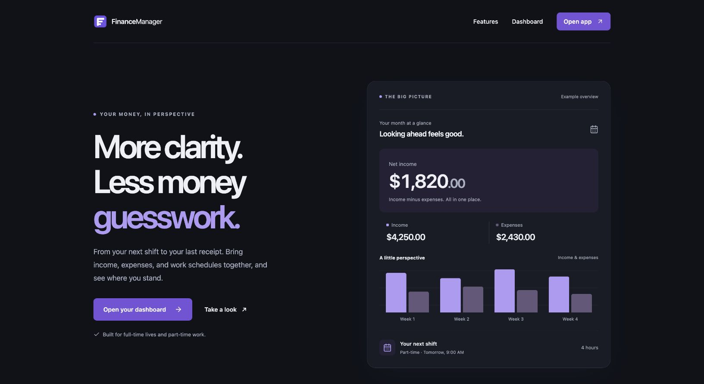

### Authentication Flow

Current login page, captured on 26 October 2026.

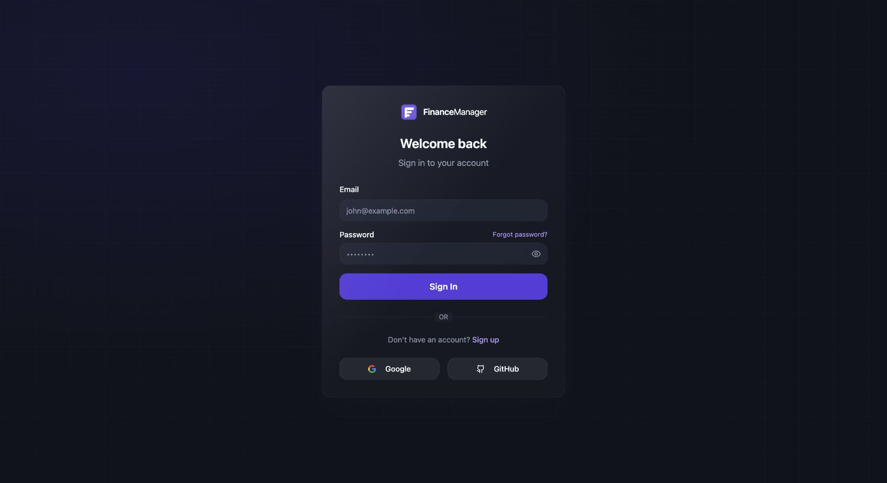

The remaining images are retained from the earlier gallery. They may differ from the current interface; updated authenticated views require a demo account with non-sensitive sample records.

| Create Account | Email Verification |
| :---: | :---: |
| 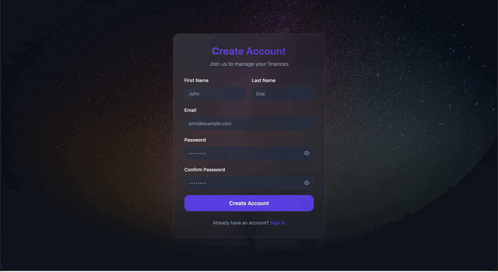 | 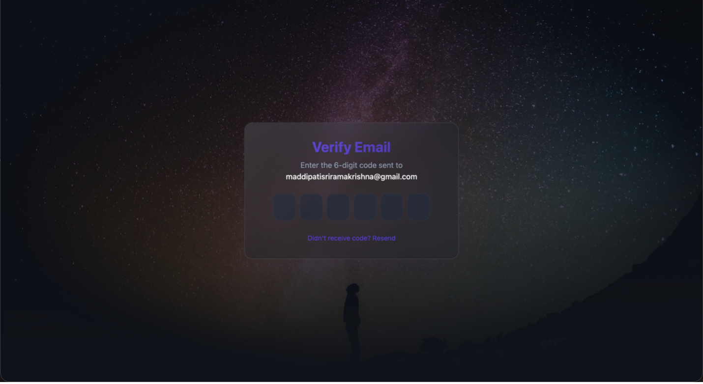 |

### Dashboard Views

| Main Dashboard | Analytics Dashboard |
| :---: | :---: |
| 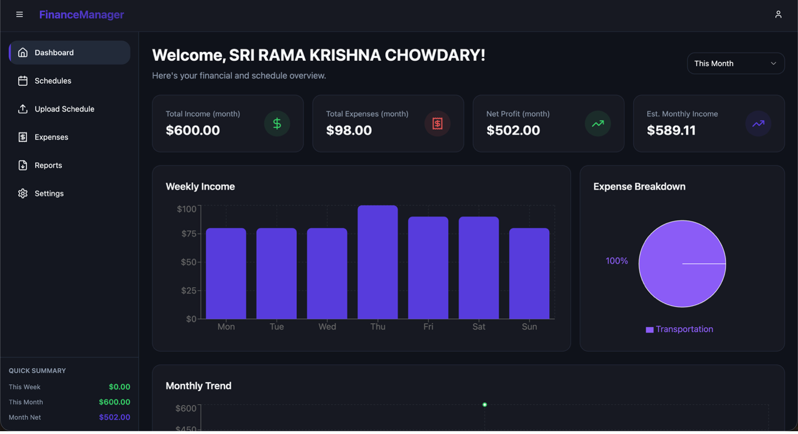 | 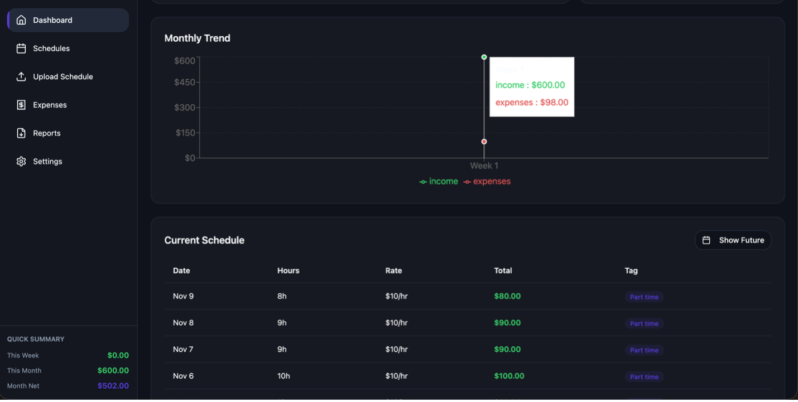 |

### Schedule Management

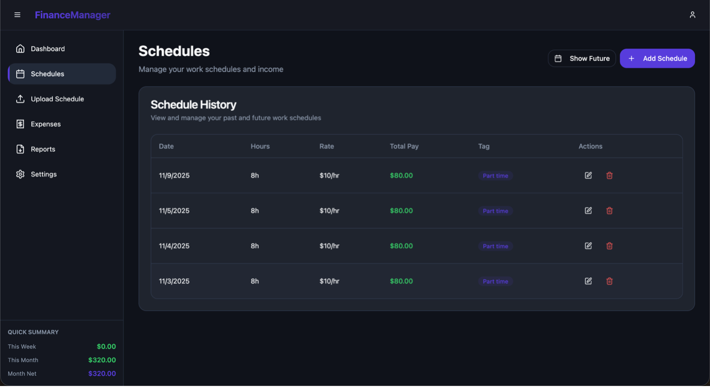

| Add Schedule | Spreadsheet Upload |
| :---: | :---: |
| 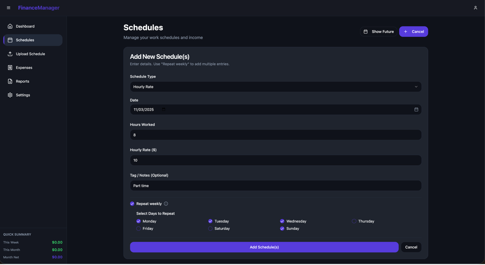 | 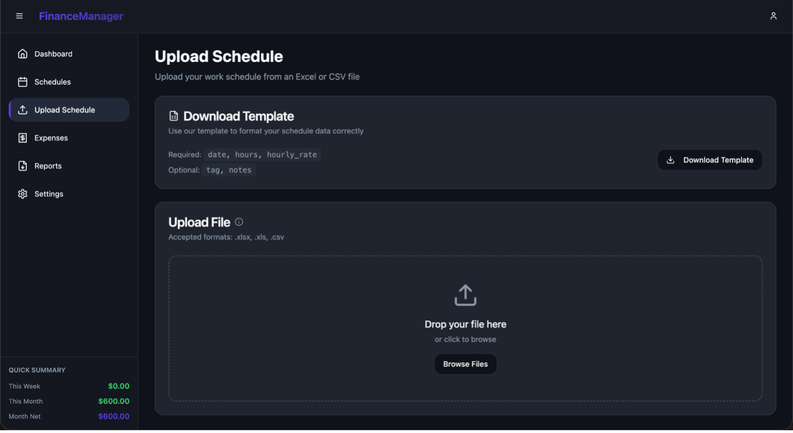 |

### Expense Management

| Expense Tracking | Expense Form |
| :---: | :---: |
| 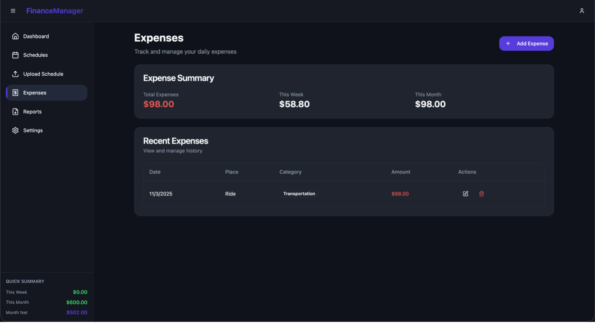 | 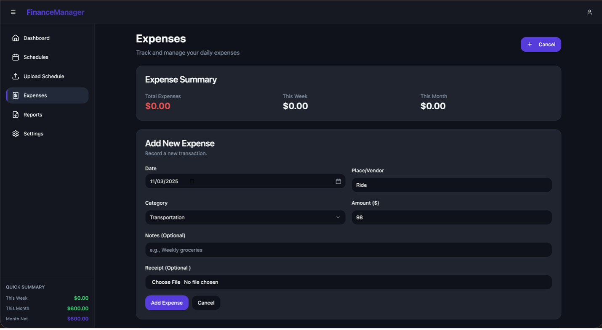 |

### Reports & Settings

| Report Generation | Settings |
| :---: | :---: |
| 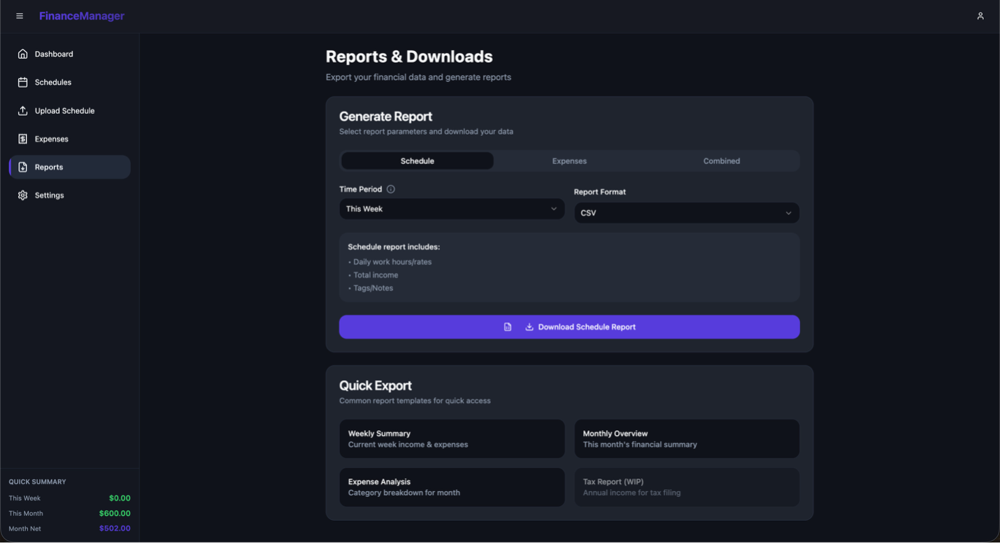 | 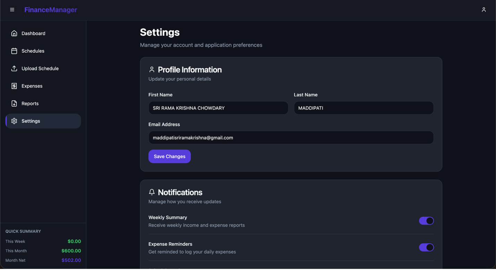 |

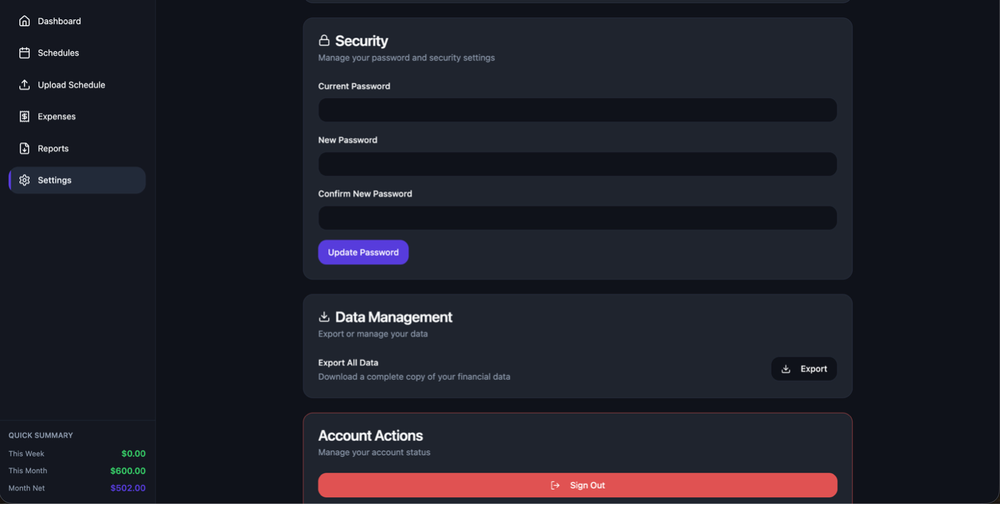

</details>

---

## 🎓 Use Cases

### For Students

Record part-time work hours and daily expenses. Review spending by category or retain a report for personal reference.

### For Professionals

Maintain schedule and expense records across work activities. Export selected records for review in a spreadsheet.

### For Part-Time Workers

Import multiple hourly shifts, inspect validation results, and compare recorded earnings with expenses. Monthly-salary records require the calculation correction described above.

---

## 🚀 Runtime Limits & Validation

| Area | Current setting |
| :--- | :--- |
| Receipt upload | 5 MB; JPEG, PNG, PDF |
| Schedule upload | 10 MB; CSV, XLS, XLSX |
| Import preview | First ten rows; counts cover parsed rows |
| Pending import | User-scoped server memory; expires after one hour |
| Authentication requests | 10 per 15-minute window |
| Protected API requests | 100 per 15-minute window |
| JWT lifetime | One hour by default |
| OAuth login ticket | One minute, single-use, bound to a verifier |

No measured dashboard latency, import speed, or time-saving percentage is claimed.

Frontend validation, from `client/`:

```bash
npm run lint
npx tsc --noEmit -p tsconfig.app.json
npm run build
```

Dependency-audit helper tests, from the repository root:

```bash
node --test scripts/audit-client.test.mjs
```

CI also checks dependencies and backend JavaScript syntax, then builds the container. These checks do not establish correctness of every financial calculation. Test registration, both social providers, import confirmation, and owned-record access with disposable data before deployment. Salary consistency needs dedicated regression coverage.

---

[](https://finance-manager-dev.onrender.com)

Render may need time to start an inactive service. Allow at least ten seconds; cold starts can take longer.

---

## 🤝 Contributing

Contributions are welcome through pull requests. Describe the affected behavior and run the relevant checks. Changes to income calculations should define the salary-allocation rule and include tests across dashboard and export paths.

---

## 📝 License

A standalone license file has not been included in this repository. Contact the maintainer for licensing terms before redistribution or reuse.

---

## 🔗 Links

- **Live Demo:** [finance-manager-dev.onrender.com](https://finance-manager-dev.onrender.com)
- **API Documentation:** `/api/docs` on the running backend
- **Report Issues:** [GitHub Issues](https://github.com/sriram629/Finance-Manager/issues)

---

**Built with ❤️ using React, TypeScript, Express, and MongoDB**

## Deploy on another platform

Use the root Dockerfile with the repository root as build context. It builds the frontend with `/api` and serves both parts from one origin. Use one application replica while import previews remain in process memory. Preserve the MongoDB connection when migrating an existing deployment.

Configure database, JWT, EmailJS, and OAuth settings as private runtime variables in the host dashboard. Production startup does not load `server/.env` automatically. Set `NODE_ENV=production` and `SERVE_CLIENT=true`; the Dockerfile already supplies these defaults. The host can override `PORT`.

After the host assigns an HTTPS domain, set `CLIENT_URL`, `SERVER_URL`, and `ALLOWED_ORIGINS` to that origin, without an `/api` suffix. Register the provider callbacks:

```text
https://YOUR-HOST/api/auth/google/callback
https://YOUR-HOST/api/auth/github/callback
```

Use `/api/health` as a process health endpoint, with a separate data-access check for database readiness. Verify both login providers and existing account records after migration. New receipts are stored in MongoDB; legacy receipts with only filesystem references require their existing upload files to remain available. Pending imports must be uploaded again after a restart.

For separate frontend hosting, set `VITE_API_URL=https://YOUR-API/api` before building and configure the exact frontend origin on the backend. The static host must serve `index.html` for client routes.
